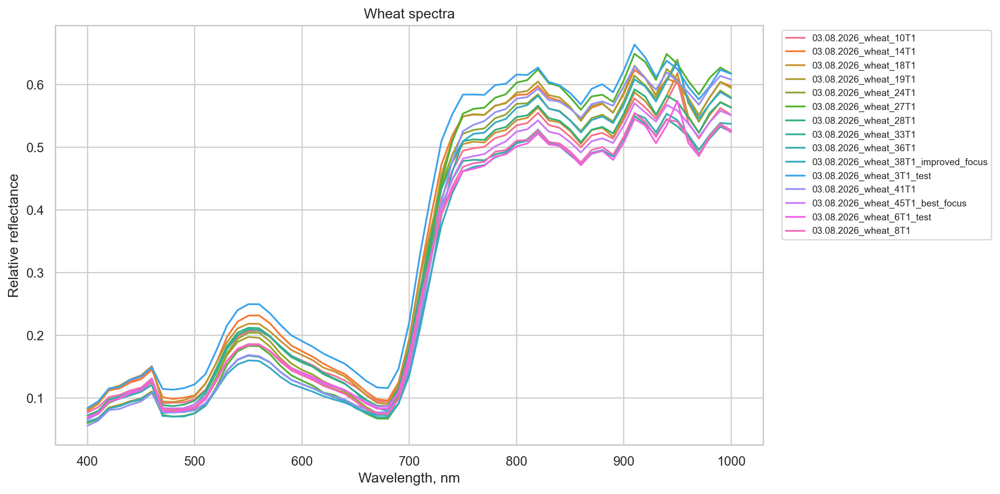
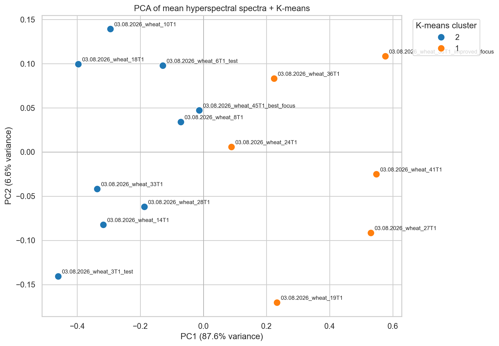
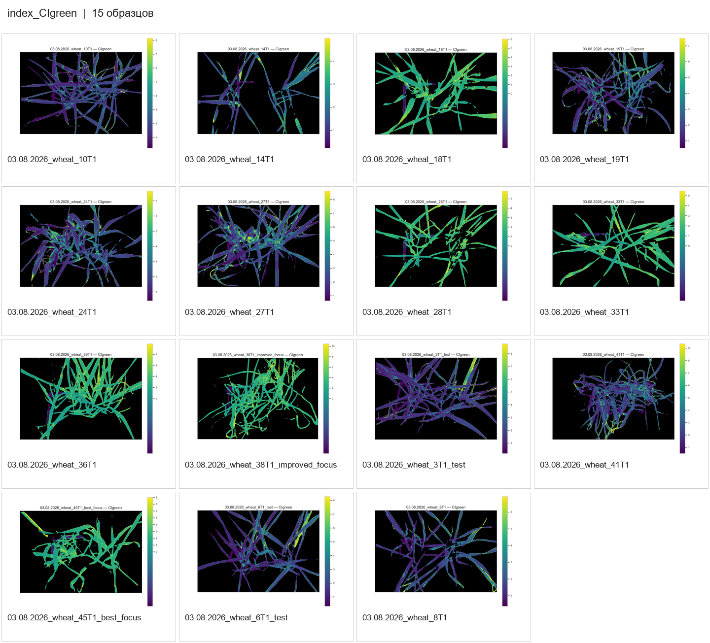

# Hyperspectral Imaging of Wheat Plants

This Python pipeline was developed for processing hyperspectral images of wheat plants collected at different stages of an experiment. It takes a set of single-band images and produces plant spectra, vegetation indices, pixel-level index maps, and figures for comparing samples. The same workflow can be applied to several experiments in one run.

The main steps are optional dark-frame subtraction, ArUco-based image alignment, flat-field correction, normalization against a Spectralon reference, and wheat segmentation using a SegFormer model. Quantitative measurements are made from the saved spectral cubes, not from the images prepared for visual inspection.

## Example results

**Mean reflectance spectra of wheat samples**



**PCA of plant spectra with K-means clustering**



**Comparison of green chlorophyll index (CIgreen) maps**



*The CIgreen collage above is from an earlier run with separate color ranges for each sample. The current pipeline uses a common range for every sample within an experiment; regenerate the maps with the notebook's final cell before comparing their colors quantitatively.*

## Requirements

The notebook is configured for **64-bit Python 3.13.9** and uses:

- NumPy, pandas, OpenCV Contrib (including `cv2.aruco`), Pillow
- Matplotlib, seaborn, scikit-learn
- PyTorch, TorchVision, Transformers, safetensors
- JupyterLab and ipykernel

The first cell of `wheat_image_processing_batch_v4_with_install.ipynb` installs the dependencies. It uses a CPU-based PyTorch installation by default, with an option for an NVIDIA CUDA build. The [`GlobalWheat/GWFSS_Segformer_b0`](https://huggingface.co/GlobalWheat/GWFSS_Segformer_b0) model is downloaded on its first use.

## Folder structure

Keep the notebook, Python modules, and `index_color_ranges.csv` together. Place the experiments in separate subfolders of the working directory:

```text
project/
├── wheat_image_processing_batch_v4_with_install.ipynb
├── process_wheat_study.py
├── index_color_ranges.csv
├── ... other Python modules ...
├── experiment_01/
│   ├── calibration_target/Spectral_Cube/
│   ├── dark/Spectral_Cube/                 # optional dark frames
│   ├── flat/Spectral_Cube/                 # gray field or large Spectralon sheet
│   ├── spectralon/Spectral_Cube/           # optional separate Spectralon target
│   ├── wheat_01/Spectral_Cube/
│   └── wheat_02/Spectral_Cube/
└── experiment_02/
    └── ...
```

Each `Spectral_Cube` contains monochrome files such as `image400.jpg`, `image410.jpg`, ..., or equivalent PNG files. The available wavelengths are read from their filenames; the acquisition step may be 5, 10, 15, or 20 nm. Calibration folders are required only when their corresponding corrections are enabled. A large Spectralon sheet can also be used as the flat-field reference.

## Running the analysis

1. Open the notebook and run the installation cell if necessary, then restart the kernel.
2. Set the correction options and check the list of experiment folders.
3. Select the folders and run the main processing cell.
4. Run the **final cell** to redraw all index maps and collages with common, experiment-wide empirical color limits. This step uses the existing cubes and masks; it does not repeat image correction or neural-network segmentation.

The pipeline can resume after an interruption: set `reuse_existing=True` and `overwrite_existing=False` to reuse available results. Set `overwrite_existing=True` for a complete rerun. With `continue_on_error=True`, an error in one sample is logged while processing continues with the others.

## Vegetation indices and color scales

The pipeline calculates **37 vegetation indices** from the quantitative spectral cubes. When a required wavelength was not measured, its value is estimated by **linear interpolation** between neighboring measured bands. Values outside the acquired wavelength range are not extrapolated: the table contains `NA` and the corresponding map is white.

The editable `index_color_ranges.csv`, stored next to the Python modules, provides initial limits for each index. Some indices use a **fixed display range** (for example, 0–1 for NDVI in green vegetation), while others use **adaptive ranges**. During processing, the pipeline records observed values in `index_ranges_per_sample.csv` and `index_ranges_empirical.csv` inside each experiment folder. The final notebook cell rebuilds maps and collages using consistent empirical limits for the adaptive indices.

This makes colors comparable **between plants within the same experiment**. For comparisons between different experiments, use the same fixed or initial limits instead of separate empirical ranges. The color limits affect visualization only; they do not modify the index values.

## Output files

Results are saved inside each experiment, including:

| Output | Contents |
|---|---|
| `wheat_01/corrected_images/corrected_cube.npz` | Quantitative hyperspectral cube (`float16` by default) |
| `wheat_01/corrected_images/` | Preview bands for checking the corrections |
| `wheat_01/wheat_mask.png`, `wheat_rgb.png`, `wheat_overlay.png`, `wheat_classes.png` | Segmentation and visual inspection |
| `wheat_01/index_maps/` | Maps of the vegetation indices |
| `spectra_mean.csv`, `spectra_std.csv`, `spectra_long.csv` | Mean spectra and pixel statistics |
| `vegetation_indices.csv` | Indices for each sample, with interpolation indicators |
| `index_ranges_per_sample.csv`, `index_ranges_empirical.csv` | Measured ranges used for consistent color scales |
| `wheat_spectra.png`, `wheat_pca.png`, `wheat_pca_scores.csv` | Spectral plots and multivariate analysis |
| `collage_index_*.png`, `collage_wheat_*.png` | Comparisons across samples |
| `processing_report.csv`, `study_stages_report.csv`, and log files | Progress and errors |

**Calibration note.** Spectralon reflectance is assumed to be 1 at each wavelength. The resulting data represent *relative reflectance*, and their accuracy depends on consistent imaging conditions and suitable reference measurements. The reference assumption alone does not establish absolute reflectance calibration.
