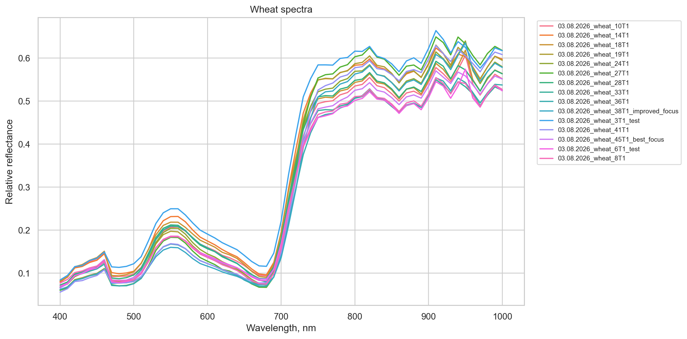
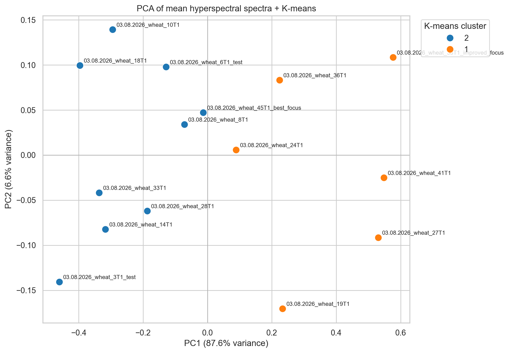
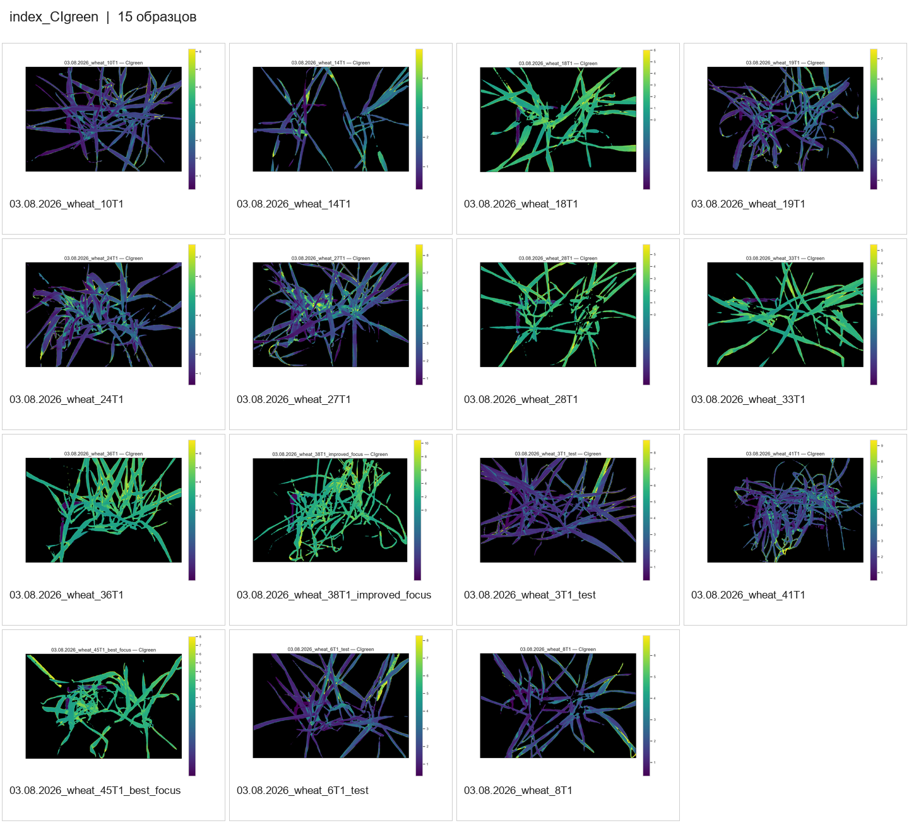

# Hyperspectral Imaging of Wheat Plants

This Python/Jupyter pipeline processes hyperspectral images of wheat plants (and other plant species) acquired at different stages of an experiment. Starting from wavelength-specific monochrome images, it produces calibrated spectral cubes, editable plant masks, mean reflectance spectra, vegetation indices, pixel-level index maps, colorimetric RGB reconstructions, and figures for comparing genotypes and growing conditions across observation dates. Multiple experiments can be processed with the same workflow.

The processing sequence combines optional dark-frame subtraction, ArUco-based image registration, flat-field correction, normalization to a Spectralon reference, optional aperture (iris) correction, and plant segmentation. Quantitative analyses use the saved hyperspectral cubes rather than the RGB images used for visual inspection or segmentation.

## Example results

**Mean reflectance spectra of wheat samples**



**PCA of plant spectra with K-means clustering**



**Comparison of green chlorophyll index (CIgreen) maps**



## Requirements

The main notebook is configured for **64-bit Python 3.13.x** (developed for Python 3.13.9). Its installation cell installs the required packages, including:

- NumPy, pandas, SciPy, Pillow, OpenCV Contrib (including `cv2.aruco`)
- Matplotlib, seaborn, scikit-learn
- PyTorch, TorchVision, Transformers, safetensors
- JupyterLab, ipykernel, ipywidgets, ipympl
- [`colour-science`](https://www.colour-science.org/) for spectral CIE colorimetry

Open the notebook in JupyterLab, run **Stage 0** to install dependencies, and restart the kernel. Its installation cell offers CPU and compatible NVIDIA CUDA options for PyTorch.

Automatic wheat segmentation uses the [`GlobalWheat/GWFSS_Segformer_b0`](https://huggingface.co/GlobalWheat/GWFSS_Segformer_b0) model, downloaded on first use and then reused locally. Interactive SAM1 segmentation requires its model weights. Optional text-prompt segmentation requires a separately installed [SAM 3](https://github.com/facebookresearch/sam3) implementation and accessible checkpoints; SAM3 weights are not included. Some interactive tools require a suitable Jupyter widget backend and, depending on the model, GPU resources.

## Folder structure

Keep the notebook, Python modules, `index_color_ranges.csv`, and index catalog files together. Organize acquisitions by experiment, with one subfolder per sample or reference:

```text
project/
├── wheat_image_processing_batch_v7.ipynb
├── process_wheat_study.py
├── hyperspectral_object_analysis.py
├── spectral_colorimetry.py
├── index_color_ranges.csv
├── ... other Python modules ...
├── experiment_01/
│   ├── calibration_target/Spectral_Cube/
│   ├── dark/Spectral_Cube/                # optional dark frames
│   ├── flat/Spectral_Cube/                # gray reference for flat-field correction
│   ├── spectralon/Spectral_Cube/          # Spectralon reflectance reference
│   ├── reference_open_iris/Spectral_Cube/ # optional aperture comparison
│   ├── reference_closed_iris/Spectral_Cube/
│   ├── Erebus_cw_d1_rep01/
│   │   ├── Spectral_Cube/
│   │   │   ├── image400.jpg
│   │   │   ├── image410.jpg
│   │   │   └── ...
│   │   └── Images/                       # segmentation preview images
│   └── Prometei_hd_d1_rep01/
│       ├── Spectral_Cube/
│       └── Images/
└── experiment_02/
    └── ...
```

The camera setup used in this project typically provides **400–1000 nm** measurements at **10 nm** intervals (61 bands), although the pipeline reads available wavelengths from filenames and can accommodate other acquisition steps. The input images can be JPEGs or supported PNGs. The reference folder markers (`calibration_target`, `flat`, `spectralon`, `dark`, and others) are configurable, and the program recognizes them as substrings of folder names. Folders marked with `#` are excluded.

The `Images` directory is used to save the RGB preview used for manual mask generation as `mask_preview.png`. It is kept alongside `Spectral_Cube`; other camera-generated images, when present, are not required for spectral analysis.

## Running the analysis

The notebook separates processing into independent stages. Once calibrated cubes have been saved, later stages can be rerun without repeating calibration.

| Stage | Purpose | Main results |
|---|---|---|
| **0 — Installation** | Install Python dependencies and restart the kernel | Python environment |
| **Configuration** | Select experiments, reference folders, correction settings, indices, masks, and spectral variant | Notebook settings |
| **Optional iris diagnostics** | Compare open-/closed-aperture reference series and inspect the coefficient across wavelengths | Iris correction report, CSV tables, graph |
| **1 — Calibration** | Dark correction, ArUco alignment, spatial flat-field correction, Spectralon normalization, optional iris multiplier | `corrected_cube.npz` and corrected preview bands |
| **2 — Segmentation** | Prepare initial masks with SegFormer or select an interactive method | `masks/object_*.png` |
| **2a — Manual mask editing** | SAM points/text where supported, intensity/HSV thresholds, brush, eraser, undo, save | Editable object masks and an RGB preview |
| **3 — Object analysis** | Four kinds of mean spectra, numerical indices, index maps, 10-bin pixel distributions, spatial PCA, colorimetric RGB images | XLSX tables, PNG maps, PCA images |
| **4 — Experimental comparisons** | Group samples by genotype, environment, and date; generate collages and comparative statistics | Date-specific PCA, spectra, boxplots, and organized image collections |

A previously processed study can be resumed with `reuse_existing=True` and `overwrite_existing=False`. Use `overwrite_existing=True` when recalibration is required. If `continue_on_error=True`, errors are logged per sample while the remaining samples continue to process when possible.

### Calibration and aperture correction

When enabled, dark correction is applied before registration and reference-based normalization. ArUco markers support the geometric alignment of wavelength bands. Flat-field correction addresses spatially varying illumination/sensitivity, while a Spectralon measurement supplies the spectral reference.

The optional iris correction is intended for experiments in which **plants were photographed with the working/open aperture, while the Spectralon reference was photographed with a smaller aperture**. The pipeline searches for exactly one folder containing `open_iris` and one containing `closed_iris` (case-insensitive; additional text in the folder names is allowed). Both series must depict the **same stationary reference** under otherwise unchanged acquisition conditions.

At each wavelength, the software compares corresponding pixels that fall within **10–245 DN in both 8-bit frames** (with proportionally adjusted thresholds for higher bit depths). It obtains a robust closed/open ratio for each usable wavelength and averages those ratios over **500–700 nm** by default. The resulting **single scalar coefficient** is applied to the corrected object cube before storage as `float16`. A per-wavelength plot indicates whether the single-coefficient assumption is reasonable.

If the pair is absent, or iris correction is disabled, no aperture multiplier is applied (`k = 1`). This assumes the sample and Spectralon acquisition settings are sufficiently comparable; the software cannot infer their actual aperture positions. Aperture changes can also alter vignetting, so a flat field acquired at a different aperture may not provide a perfect spatial correction.

**Calibration note:** the reference is treated as having reflectance `ρ = 1` at all measured wavelengths. The resulting quantities represent *relative reflectance*, not metrologically traceable absolute reflectance. Reliable quantitative comparisons also depend on consistent illumination, geometry, exposure, sensor response, and signal linearity. JPEG encoding or in-camera processing may introduce nonlinearities that a simple reference ratio cannot remove.

### Plant masks and RGB previews

The pipeline supports automatic SegFormer masks and an interactive mask editor for individual objects. The editor supports positive/negative SAM1 point prompts, optional SAM3 text prompts, thresholding on **HSV value (V, 0–255)** and/or **HSV hue (0–360°)**, and manual refinement with brush, eraser, and undo. A threshold can use lower and upper bounds; hue intervals that wrap around 0° are supported. Text prompts are not provided for SAM1.

Mask images are saved as binary PNGs in `sample/masks/`. Multiple objects can be saved as `object_01.png`, `object_02.png`, etc. Legacy `wheat_mask.png` files remain supported. The available analysis modes are `individual`, `union`, and `full`; in the absence of an object mask the full valid frame may be analyzed, so review the segmentation before interpreting plant-level measurements.

Two RGB preview methods are available for the manual editor:

- **`fast`** — a three-band RGB composite, using 630/530/470 nm by default and a display-oriented intensity stretch.
- **`accurate`** — spectral conversion of calibrated reflectance through **CIE 1931 XYZ (2° observer, D65) to sRGB**, using the available visible bands from 400–780 nm.

The editor's RGB image is saved to `sample/Images/mask_preview.png` by default. The `accurate` option is slower because it uses spectral information across the visible part of the cube. SegFormer continues to use the input representation expected by its model.

### Spectra, vegetation indices, and color scales

The current index library contains **36 descriptors**, grouped in nested presets:

- **Minimal:** 8 indices
- **Medium (default):** 22 indices
- **Maximum:** all 36 indices

The medium preset includes the experimental **epicuticular wax ratio indices**:

```python
EWRI_410_900 = R410 / R900
EWRI_410_950 = R410 / R950
```

Both are intended as exploratory spectral descriptors of epicuticular wax properties, rather than validated direct measurements of wax quantity or quality. The medium preset also includes **`CSIB = R525/R800`** (an exploratory stress descriptor originating from research on Brassica species) and **`Hue_LCh`**, the hue angle calculated from the original reflectance spectrum under CIE 1931 2°/D65. `Hue_LCh` is distinct from the HSV hue of the image used to create a mask.

Missing wavelengths **between** acquired bands are estimated by linear interpolation. Measurements are **not extrapolated** beyond the available spectral range; unavailable indices are reported as missing values, with blank/white maps when necessary. The exact formulas and required bands are documented in `index_preset_catalog.csv` and the generated `selected_indices.xlsx`.

For every segmented object, the pipeline retains **four mean-spectral variants** in separate XLSX files:

1. `raw` — original mean reflectance spectrum.
2. `raw_normalized` — each original mean spectrum divided by its own spectral mean (**default for downstream comparisons**).
3. `savgol` — Savitzky–Golay-smoothed mean spectrum.
4. `savgol_normalized` — each smoothed spectrum divided by its own mean.

The notebook variable `SPECTRAL_VARIANT` selects the variant used for indices calculated **from mean spectra** and for Stage 4 spectral analyses. All four spectra and their index tables are saved regardless of the selection. **Pixelwise index maps and their statistics always use the original calibrated spectral cube.** An index computed from a mean spectrum is not necessarily equal to the mean of the index values across pixels.

Ratio-based indices such as EWRI remain numerically invariant under positive per-spectrum scaling, but indices with additive constants or inverse-reflectance terms may lose their usual physical meaning after mean normalization. `Hue_LCh` always uses the **unnormalized reflectance spectrum**.

The editable `index_color_ranges.csv` provides fixed or adaptive color limits. The program also determines study-level empirical limits for applicable indices so that a particular map color corresponds to the same numeric value across samples within a study. Display limits do **not** alter the calculated index values.

Each pixelwise index map also contributes statistics to `index_ranges_by_object.xlsx`, including **10 equal-width bins between that object's observed minimum and maximum**. The bin counts are computed from numerical pixel values inside the selected mask, not from PNG colors. Bin boundaries are retained in `index_histogram_bins.xlsx`; when comparing distributions across objects, compare the actual boundaries rather than bin numbers alone.

### Colorimetric RGB reconstruction

In addition to vegetation-index heatmaps, Stage 3 can create a colorimetric RGB reconstruction for each analyzed region. Using the same spectral integration underlying `Hue_LCh`, calibrated pixel spectra are transformed to **CIE XYZ** with a standard **D65 illuminant** and **CIE 1931 2° observer**, then encoded as **sRGB**. Only the available visible portion of the cube (400–780 nm) contributes to these color calculations; near-infrared bands are not used for visible-color rendering.

The outputs are saved as **`Color_RGB.png`** next to the corresponding index maps, with the **same object mask** applied when a masked map is requested. These PNG files contain no title or color bar. The feature is enabled by default and can be switched off with `render_color_images=False` in the Stage 3 analysis call.

The reconstructed colors are an approximation to standardized viewing conditions, not a camera photograph or a guarantee of perfect color fidelity. Accuracy depends on the reference calibration, spectral sampling, the missing 380–390 nm range, possible out-of-gamut clipping, and the display used to view the result.

### Comparing genotypes and experimental conditions

Stage 4 reads three pairs of code/display lists: **genotypes**, **environments**, and **observation dates**. A sample folder must contain exactly one code for each dimension (case-insensitive substring matching); unmatched or ambiguous samples are reported and excluded from grouped plots. User-provided display labels appear in the figures.

```python
# Example: names of sample folders contain these short codes
genotypes_codes = ['g1', 'g2']
genotypes_display = ['Cultivar_1', 'Cultivar_2']

environment_codes = ['cw', 'cd', 'hw', 'hd']
environment_display = ['Cold / wet', 'Cold / dry', 'Hot / wet', 'Hot / dry']

dates_codes = ['d1', 'd2']
dates_display = ['Observation 1', 'Observation 2']
```

For **each observation date separately**, Stage 4 generates:

- Index and reconstructed-color collages arranged by **genotype × environment**.
- Copies of the individual index maps and `Color_RGB.png` images, organized by date, index/image type, and experimental treatment.
- Mean spectra by treatment and genotype, with shaded **± standard deviation** where multiple object observations are available.
- One **boxplot with overlaid individual scatter points** for every selected spectral index.
- PCA of selected object-mean spectra, with optional K-means clustering diagnostics.
- XLSX tables containing grouping information, indices, PCA scores, spectral summary statistics, and image locations.

The original sample folders and maps are **not moved**. PCA is fitted independently for each date, so scores and principal axes from different dates are not automatically comparable. Pixels and multiple object masks must not be treated as independent biological replicates without an appropriate experimental design.

## Output files

A typical processed study contains the following results (availability depends on the stages and options used):

| Output | Contents |
|---|---|
| `sample/corrected_images/corrected_cube.npz` | Calibrated spectral cube, `float16` by default |
| `sample/corrected_images/` | Corrected monochrome preview bands |
| `sample/Images/mask_preview.png` | RGB preview used for interactive mask generation |
| `sample/masks/object_01.png`, `object_02.png`, ... | Editable binary masks for individual objects |
| `sample/object_analysis/index_maps/<mask>/NDVI.png` | Pixelwise index heatmap for a selected region |
| `sample/object_analysis/index_maps/<mask>/EWRI_410_900.png` | Pixelwise experimental wax-ratio map |
| `sample/object_analysis/index_maps/<mask>/Color_RGB.png` | Reconstructed, mask-aware sRGB image |
| `sample/pca_maps/<mask>/` | Spatial PCA score maps and false-color PCA composites |
| `object_analysis/objects.xlsx`, `spectra_long.xlsx` | Object identifiers and wavelength-level spectra/statistics |
| `object_analysis/spectra_mean_<variant>.xlsx` | Four complete sets of mean spectra |
| `object_analysis/indices_<variant>.xlsx`, `indices_selected.xlsx` | Indices from each spectrum variant and the active selection |
| `object_analysis/index_ranges_by_object.xlsx` | Pixelwise index statistics and 10-bin counts |
| `object_analysis/index_histogram_bins.xlsx` | Explicit per-object bin boundaries and frequencies |
| `object_analysis/index_maps_report.xlsx` | Generated image paths, mask identifiers, and scale metadata |
| `object_analysis/selected_indices.xlsx`, `analysis_settings.json` | Formulas and analysis configuration |
| `object_analysis/experiment_objects.xlsx` | Genotype/environment/date assignments and matching status |
| `object_analysis/by_date/<date>/collages/collage_<index>.png` | Date-specific treatment collages, including `collage_Color_RGB.png` |
| `object_analysis/by_date/<date>/maps_by_index/<index>/<genotype__environment>/` | Copied original index maps and reconstructed RGB images, organized by treatment |
| `object_analysis/by_date/<date>/index_boxplots/` | Date-specific boxplots and observation points |
| `object_analysis/by_date/<date>/spectra_by_genotype_environment.png` | Date-specific group mean spectra with SD bands |
| `object_analysis/by_date/<date>/pca/` | Mean-spectrum PCA figures, scores, loadings and variance (XLSX) |
| `iris_correction_report.json`, `iris_correction_spectrum.png` | Optional aperture-calibration diagnostics |

Tabular **`object_analysis` results are exported as XLSX**, making them directly accessible in Excel. Calibration and processing diagnostics stored elsewhere may still use CSV or JSON.

## Usage of AI

The code in this repository was primarily generated with assistance from **GPT-6 (OpenAI)**. The author provided the scientific methodology, experimental requirements, technical specifications, and oversight of the implementation.
